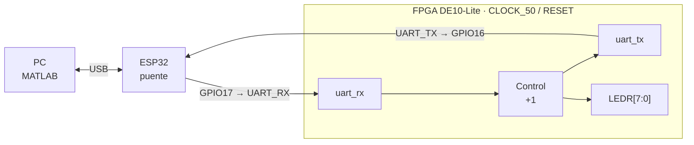
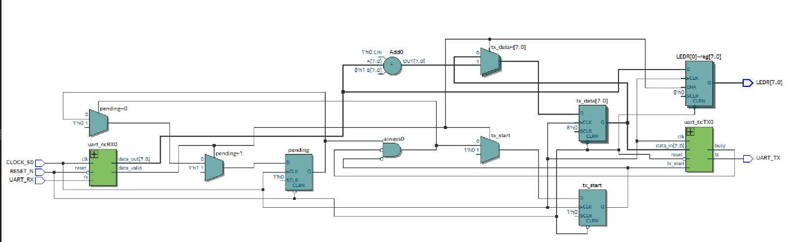
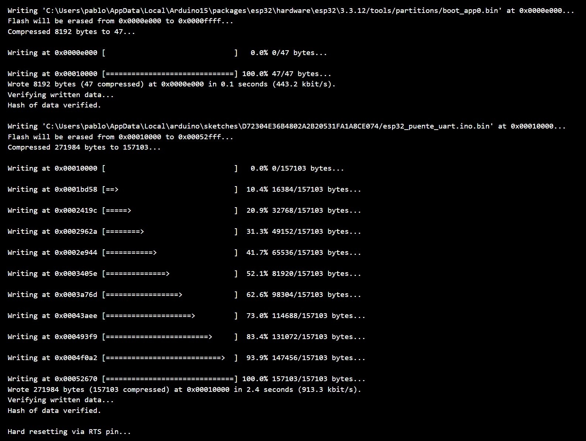
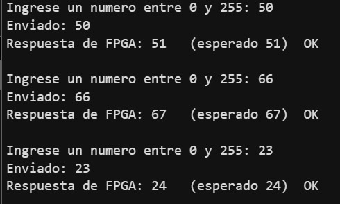

# Práctica 4: Comunicación bidireccional UART entre FPGA DE10-Lite y computadora usando MATLAB y ESP32

**Universidad de las Américas Puebla** · Sistemas Embebidos · O26-LRT3032-3
**Profesor:** Gerardo Ulices Díaz
**Integrantes:** Diego Camargo (180892) · Pablo Robles (166855) · Bruno García (177613)
**Entrega:** 30 de octubre de 2026

## Contenido

- [Resumen](#resumen)
- [Objetivos](#objetivos)
- [Marco teórico](#marco-teórico)
- [Diseño del experimento](#diseño-del-experimento)
- [Desarrollo del experimento](#desarrollo-del-experimento)
- [Resultados](#resultados)
- [Conclusión](#conclusión)
- [Cuestionario](#cuestionario)
- [Código fuente](#código-fuente)
- [Cómo reproducir la práctica](#cómo-reproducir-la-práctica)
- [Referencias](#referencias)

## Estructura del repositorio

```text
.
├── README.md
├── fpga/
│   ├── top_uart_de10lite.v      # módulo superior (recibe, suma 1, retransmite)
│   ├── uart_rx.v                # receptor UART 8N1 (corregido)
│   ├── uart_tx.v                # transmisor UART 8N1
│   └── pines_de10lite.qsf       # asignación de pines (plantilla)
├── sim/
│   └── tb_uart.v                # testbench (Icarus Verilog)
├── esp32/
│   └── esp32_puente_uart/
│       └── esp32_puente_uart.ino
├── matlab/
│   ├── uart_transmision.m
│   ├── uart_recepcion.m
│   └── uart_bidireccional.m
└── images/                      # capturas usadas en este README
```

## Resumen

En este reporte se implementa un enlace serial UART bidireccional a 9600 baudios, formato 8N1, entre la tarjeta Terasic DE10-Lite y una computadora. Como la PC no se conecta directamente a la FPGA, se emplea un ESP32 programado en Arduino IDE como puente transparente USB–UART, y desde MATLAB se utiliza el objeto `serialport` para enviar y recibir bytes. En la FPGA se describen en Verilog un receptor y un transmisor UART, ambos temporizados con un divisor de ≈5208 ciclos por bit a partir del reloj de 50 MHz, y una lógica de control que almacena el byte recibido, le suma una unidad y lo retransmite. La verificación experimental muestra que, para los valores enviados desde MATLAB (50, 66 y 23), la FPGA respondió siempre con el valor esperado (51, 67 y 24), y que el programa del ESP32 se cargó correctamente.

**Palabras clave:** FPGA, ESP32, UART, MATLAB, comunicación bidireccional, Verilog.

## Objetivos

- Diseñar e implementar un sistema de comunicación serial bidireccional entre la FPGA DE10-Lite y una computadora mediante UART a 9600 baudios, 8 bits de datos, sin paridad y 1 bit de paro.
- Describir en Verilog los módulos `uart_rx` y `uart_tx` y un módulo superior que procese al menos un byte recibido.
- Programar un ESP32 como puente transparente USB–UART entre la PC y la FPGA.
- Utilizar scripts de MATLAB para transmitir, recibir y validar datos de forma bidireccional.
- Comparar los resultados esperados contra los obtenidos experimentalmente.

## Marco teórico

### Comunicación serial UART

UART (*Universal Asynchronous Receiver Transmitter*) es un método de comunicación serial asíncrona en el que transmisor y receptor no comparten una señal de reloj; en su lugar, ambos se configuran con la misma velocidad de transmisión o *baud rate* [[1]](#ref1). La línea permanece en alto en reposo y cada byte viaja dentro de una trama que contiene un bit de inicio (nivel bajo), los bits de datos enviados desde el menos significativo, un bit de paridad opcional y uno o más bits de paro (nivel alto) [[1]](#ref1), [[2]](#ref2). En esta práctica se usa la configuración 8N1 (Figura 1), por lo que cada byte ocupa 10 bits en la línea.


*Figura 1. Trama UART 8N1: bit de inicio, 8 bits de datos (LSB primero) y 1 bit de paro.*

### Baud rate y divisor de reloj

Como no existe una línea de reloj compartida, ambos extremos deben coincidir en la velocidad; de lo contrario el receptor muestrea los bits fuera de su centro y aparecen errores de trama [[2]](#ref2). Con $f_{CLK}=50$ MHz y 9600 baudios, el número de ciclos de reloj por bit es

$$
N=\frac{f_{CLK}}{\text{baud}}=\frac{50\,000\,000}{9600}\approx 5208.33 \Rightarrow 5208
$$

que al truncarse produce una velocidad efectiva de $50\times10^{6}/5208\approx 9600.6$ baudios, es decir, un error relativo de ≈ 0.006 %, despreciable frente a la tolerancia típica de la UART (alrededor de ±3 %). Cada bit dura $1/9600\approx 104.2\ \mu s$ y un byte completo (10 bits) ≈ 1.04 ms.

### UART frente a RS-232 y niveles lógicos

UART define el formato de la trama y su temporización, pero no los niveles eléctricos. RS-232, en cambio, es un estándar eléctrico en el que los niveles de voltaje son del orden de ±3 a ±15 V y la lógica es invertida [[3]](#ref3). Por ello una señal RS-232 clásica no debe conectarse a un GPIO de 3.3 V sin un convertidor de nivel. La FPGA DE10-Lite y el ESP32 trabajan ambos con lógica de 3.3 V [[4]](#ref4), por lo que se pueden interconectar directamente siempre que se comparta tierra.

### ESP32 como puente USB–UART

El ESP32 dispone de varias UART por hardware. En el entorno Arduino, `Serial` corresponde al puerto USB hacia la PC y `HardwareSerial(2)` permite configurar una segunda UART con pines definidos por el usuario [[5]](#ref5). Un programa que reenvía byte a byte lo recibido por una UART hacia la otra convierte al ESP32 en un puente transparente, de modo que, para MATLAB, la FPGA parece estar conectada directamente a un puerto serial virtual. La arquitectura resultante es

$$
\text{PC}\leftrightarrow\text{USB}\leftrightarrow\text{ESP32}\leftrightarrow\text{UART}\leftrightarrow\text{FPGA}
$$

### Comunicación serial desde MATLAB

En versiones recientes de MATLAB la comunicación serial se realiza con el objeto `serialport`, que abre el puerto COM, y las funciones `write` y `read` para enviar y leer datos con un tipo definido (por ejemplo, `uint8`); la propiedad `NumBytesAvailable` indica cuántos bytes esperan en el búfer de recepción [[6]](#ref6).

## Diseño del experimento

### Arquitectura

El sistema (Figura 2) se compone de la computadora con MATLAB, el ESP32 como puente y, dentro de la FPGA, un módulo receptor, la lógica de control con el procesamiento del dato y un módulo transmisor, todos sincronizados al reloj de 50 MHz (`CLOCK_50`).



*Figura 2. Diagrama de bloques del sistema.*

### Conexión física

La UART2 del ESP32 se asignó a GPIO16 (RX) y GPIO17 (TX), y la conexión con la FPGA se realiza de forma cruzada, con tierra común (Cuadro 1). Es indispensable compartir la tierra para que ambos dispositivos tengan la misma referencia de voltaje.

| ESP32 | Sentido | FPGA DE10-Lite |
|:--|:--:|:--|
| GPIO17 (TX) | → | `UART_RX` |
| GPIO16 (RX) | ← | `UART_TX` |
| GND | ↔ | GND |

*Cuadro 1. Conexión UART cruzada entre ESP32 y FPGA.*

### Entradas y salidas de la FPGA

| Señal | Función |
|:--|:--|
| `CLOCK_50` | Reloj de 50 MHz de la tarjeta |
| `RESET_N` | Reinicio (activo en bajo) |
| `UART_RX` | Entrada serial desde el ESP32 |
| `UART_TX` | Salida serial hacia el ESP32 |
| `LEDR[7:0]` | Byte procesado, mostrado en LEDs |

*Cuadro 2. Entradas y salidas del módulo superior.*

### Cálculo de parámetros

Los módulos de la FPGA se parametrizan con `CLK_FREQ`=50 000 000 y `BAUD_RATE`=9600, de modo que `CLKS_PER_BIT`=5208 y `HALF_BIT`=2604. El contador de ciclos usa 16 bits, suficientes para representar 5207 (máximo valor de cuenta).

## Desarrollo del experimento

### Codificación de los módulos en Verilog

**`uart_tx`.** Al recibir un pulso en `tx_start` y con `busy`=0, carga un registro de desplazamiento de 10 bits con `{1, dato, 0}` (paro, datos y inicio), activa `busy` y envía un bit cada `CLKS_PER_BIT` ciclos, empezando por el bit de inicio y el LSB. Al terminar los 10 bits regresa la línea a nivel alto y baja `busy`.

**`uart_rx`.** Detecta la caída de la línea `rx` (bit de inicio), espera medio bit para ubicarse en el centro de cada bit y luego muestrea los 8 bits de datos cada `CLKS_PER_BIT` ciclos, guardándolos en un registro de desplazamiento. Al finalizar entrega el byte en `data_out` y genera un pulso de un ciclo en `data_valid`.

**`top_uart_de10lite`.** Integra ambos módulos y realiza el procesamiento. Como se aprecia en el RTL de la Figura 3, el pulso `data_valid` del receptor activa un registro `pending`; cuando `pending`=1 y el transmisor no está ocupado (`busy`=0), se carga en `tx_data` el byte recibido más 1 (sumador de 8 bits `Add0`), se genera el pulso `tx_start` y se limpia `pending`. El mismo valor se registra en `LEDR[7:0]`. El registro `pending` evita perder un byte si éste llega mientras el transmisor aún está enviando.



*Figura 3. Vista RTL (RTL Viewer) de Quartus del módulo superior: `uart_rx`, registro `pending`, sumador +1, registros `tx_data` y `tx_start`, `uart_tx` y salida `LEDR[7:0]`.*

### Programa del ESP32 en Arduino IDE

El ESP32 se programó con Arduino IDE [[7]](#ref7) usando el sketch `esp32_puente_uart.ino` ([ver código](#esp32-esp32_puente_uartino)), que reenvía en ambos sentidos cada byte recibido.

### Scripts de MATLAB

Se utilizó un script de transmisión, uno de recepción y uno bidireccional. En todos se crea el objeto `serialport` con el puerto COM del ESP32 y 9600 baudios, y se incluye una pausa de 2 s tras abrirlo porque el ESP32 puede reiniciarse al abrir el puerto. En el script bidireccional se solicita un valor entre 0 y 255, se envía como `uint8`, se espera 0.1 s y se lee la respuesta de la FPGA; en la versión empleada, el script además calcula el valor esperado (dato +1) y lo compara con la respuesta, imprimiendo `OK` cuando coinciden.

### Implementación en Quartus

El diseño se sintetizó en Intel Quartus Prime para el dispositivo MAX 10 de la DE10-Lite con `top_uart_de10lite` como entidad superior y `CLOCK_50` como reloj. Se asignaron los pines de `CLOCK_50`, `RESET_N`, `LEDR[7:0]` y dos GPIO de la tarjeta para `UART_RX` y `UART_TX` [[4]](#ref4). El diseño se programó en la FPGA mediante el cable USB Blaster.

## Resultados

### Carga del programa en el ESP32

En la Figura 4 se muestra la salida de Arduino IDE al cargar el *sketch*. El programa compilado ocupa 271 984 bytes (157 103 bytes comprimidos), se escribió a partir de la dirección `0x00010000` en 2.4 s y la herramienta verificó el *hash* de los datos escritos, tras lo cual reinició la tarjeta mediante el pin RTS.



*Figura 4. Carga del programa `esp32_puente_uart.ino` en el ESP32 desde Arduino IDE.*

### Pruebas con MATLAB

La Figura 5 muestra la consola de MATLAB con el script bidireccional. En cada prueba se envió un valor y la FPGA respondió con el valor más uno, coincidiendo con lo esperado (Cuadro 3).



*Figura 5. Consola de MATLAB: datos enviados, respuesta de la FPGA y valor esperado.*

| Enviado | Esperado | Obtenido | Resultado |
|:--:|:--:|:--:|:--:|
| 50 | 51 | 51 | OK |
| 66 | 67 | 67 | OK |
| 23 | 24 | 24 | OK |

*Cuadro 3. Comparación entre resultados esperados y obtenidos.*

Para el caso límite, al enviar 255 la suma `rx_data + 8'd1` se trunca a 8 bits y el resultado esperado es 0 (desbordamiento modular), lo que es consistente con el comportamiento definido en la guía de la práctica.

### Análisis

Los tres valores de prueba regresaron incrementados en uno, lo que indica que se cumple toda la cadena PC → ESP32 → FPGA → ESP32 → PC. Esto confirma que el baud rate coincide en los cuatro extremos (MATLAB, UART USB del ESP32, UART2 del ESP32 y los módulos de la FPGA), que el cruce TX/RX es correcto y que el cálculo del divisor de 5208 ciclos por bit es suficientemente preciso para muestrear sin errores. Además, el tiempo de ida y vuelta de un byte es de pocos milisegundos (dos bytes de 10 bits a 9600 baudios, ≈ 2.1 ms), por lo que la pausa de 0.1 s del script es más que suficiente para recibir la respuesta.

## Conclusión

En esta práctica se diseñó e implementó un enlace UART bidireccional entre una computadora y la FPGA DE10-Lite, con un ESP32 como puente USB–UART y MATLAB como herramienta de prueba. Las pruebas realizadas mostraron que la FPGA recibe un byte, le suma una unidad y lo retransmite correctamente.

En primer lugar, la coincidencia del baud rate resultó fundamental: al no existir una señal de reloj compartida, el receptor depende de que su divisor (5208 ciclos por bit, con error de ≈0.006 %) coincida con la velocidad del transmisor, y de muestrear cada bit en su centro, para lo cual se espera medio bit tras detectar el bit de inicio. La conexión cruzada TX/RX y la tierra común fueron igualmente necesarias, pues ambos dispositivos comparten niveles de 3.3 V y no se requirió ningún convertidor de nivel.

Asimismo, el uso de un registro `pending` en la lógica de control permitió desacoplar la recepción de la transmisión, de manera que el byte recibido se conserva hasta que el transmisor queda libre. La comunicación bidireccional permite además no solo enviar comandos a la FPGA, sino recibir confirmaciones o resultados de procesamiento, lo que es útil para depuración y para aplicaciones embebidas con supervisión desde una PC.

El ESP32 demostró ser una alternativa práctica a un convertidor USB–UART TTL dedicado: con un programa de pocas líneas se obtiene un puente transparente que reutiliza hardware común de laboratorio. Finalmente, MATLAB facilitó la generación de pruebas, la captura de las respuestas y la comparación automática entre valores esperados y obtenidos, lo que hace sencillo validar experimentalmente el sistema y ampliarlo con más casos de prueba o análisis de datos [[6]](#ref6).

## Cuestionario

**1. ¿Qué diferencia existe entre UART y RS232?**
UART es el bloque (o protocolo) que define la trama serial asíncrona (bit de inicio, datos, paridad opcional y paro) y su temporización, sin especificar niveles eléctricos. RS-232 es un estándar eléctrico y de conectores que define voltajes de aproximadamente ±3 a ±15 V con lógica invertida y que suele transportar tramas generadas por una UART [[1]](#ref1), [[3]](#ref3).

**2. ¿Por qué no debe conectarse directamente una señal RS232 clásica a un pin GPIO de la FPGA?**
Porque sus niveles de voltaje exceden por mucho los 3.3 V que toleran los pines de la FPGA y podrían dañarlos; además, la lógica de RS-232 es invertida. Se requiere un convertidor de nivel (por ejemplo, un transceptor tipo MAX3232) [[3]](#ref3), [[4]](#ref4).

**3. ¿Qué función cumple el baud rate en una comunicación serial?**
Define el número de símbolos (bits) por segundo y, por tanto, la duración de cada bit (≈104.2 µs a 9600 baudios). Como no hay reloj compartido, ambos extremos deben usar el mismo valor para que el receptor muestree cada bit en el instante correcto; si no coinciden, se producen datos erróneos o errores de trama [[1]](#ref1), [[2]](#ref2).

**4. ¿Por qué la conexión entre TX y RX debe realizarse cruzada?**
Porque TX es una salida y RX una entrada: el transmisor de un dispositivo debe alimentar el receptor del otro. Conectar TX con TX dejaría a dos salidas enfrentadas y a los receptores sin señal, por lo que no habría comunicación.

**5. ¿Qué ventajas ofrece MATLAB para la prueba de sistemas embebidos con comunicación serial?**
Permite abrir y configurar el puerto con pocas líneas (`serialport`), enviar y leer tipos de datos específicos, automatizar secuencias de prueba, comparar valores esperados y obtenidos, y procesar o graficar los datos recibidos sin necesidad de un monitor serial externo [[6]](#ref6).

**6. ¿Qué función cumple el ESP32 dentro del sistema de comunicación propuesto?**
Actúa como puente transparente USB–UART: recibe por USB los bytes enviados desde MATLAB y los retransmite por su UART2 hacia la FPGA, y reenvía hacia la PC lo que la FPGA transmite, sustituyendo a un convertidor USB–UART TTL externo [[5]](#ref5).

## Código fuente

Todos los archivos están en este repositorio; aquí se incluyen completos para consulta rápida.

### Cambios respecto al código base de la guía

| Archivo | Cambio | Motivo |
|:--|:--|:--|
| `uart_rx.v` | Se reescribió como FSM `IDLE/START/DATA/STOP`, con sincronizador de 2 flip-flops en `rx` y validación del bit de paro | En el código de la guía, tras el medio bit el primer muestreo caía sobre el **bit de inicio**, por lo que los datos quedaban desplazados un bit (en simulación, enviar 50 devolvía 101) |
| `top_uart_de10lite.v` | Se añadió el registro `pending` y la salida `LEDR[7:0]` | Evita perder un byte si llega con el transmisor ocupado y muestra el resultado en la placa (ver Figura 3) |
| `uart_tx.v` | Sin cambios | Verificado en simulación |
| `esp32_puente_uart.ino` | Se eliminó el `Serial.println` de bienvenida | Esos bytes llegarían a MATLAB como si fueran una respuesta de la FPGA |
| `uart_bidireccional.m` | `flush(s)` tras abrir el puerto y antes de cada envío; cálculo del valor esperado (`mod(valor+1,256)`) y mensaje `OK`/`ERROR`; Enter vacío para salir | Descarta bytes basura del arranque del ESP32 y automatiza la comparación mostrada en la Figura 5 |

### FPGA (Verilog)

<details>
<summary><code>fpga/top_uart_de10lite.v</code></summary>

```verilog
// ============================================================
// top_uart_de10lite.v : Modulo superior (DE10-Lite)
// Recibe un byte por UART, le suma 1 y lo retransmite.
// El byte procesado tambien se muestra en LEDR[7:0].
//
// El registro 'pending' guarda que hay un byte por responder, de
// modo que no se pierde si el transmisor aun esta ocupado.
// ============================================================
module top_uart_de10lite (
    input  wire       CLOCK_50,
    input  wire       RESET_N,     // KEY0 (activo en bajo)
    input  wire       UART_RX,     // desde GPIO17 del ESP32
    output wire       UART_TX,     // hacia  GPIO16 del ESP32
    output reg  [7:0] LEDR
);

    wire reset = ~RESET_N;

    wire [7:0] rx_data;
    wire       rx_done;
    reg  [7:0] tx_data;
    reg        tx_start;
    wire       tx_busy;
    reg        pending;

    uart_rx #(.CLK_FREQ(50000000), .BAUD_RATE(9600)) RX0 (
        .clk        (CLOCK_50),
        .reset      (reset),
        .rx         (UART_RX),
        .data_out   (rx_data),
        .data_valid (rx_done)
    );

    uart_tx #(.CLK_FREQ(50000000), .BAUD_RATE(9600)) TX0 (
        .clk      (CLOCK_50),
        .reset    (reset),
        .tx_start (tx_start),
        .data_in  (tx_data),
        .tx       (UART_TX),
        .busy     (tx_busy)
    );

    always @(posedge CLOCK_50 or posedge reset) begin
        if (reset) begin
            tx_data  <= 8'd0;
            tx_start <= 1'b0;
            pending  <= 1'b0;
            LEDR     <= 8'd0;
        end else begin
            tx_start <= 1'b0;

            if (rx_done)
                pending <= 1'b1;                    // hay un byte por responder

            if (pending && !tx_busy) begin          // transmisor libre
                tx_data  <= rx_data + 8'd1;         // procesamiento: +1 (255 -> 0)
                LEDR     <= rx_data + 8'd1;
                tx_start <= 1'b1;
                pending  <= 1'b0;
            end
        end
    end

endmodule
```
</details>

<details>
<summary><code>fpga/uart_rx.v</code></summary>

```verilog
// ============================================================
// uart_rx.v : Receptor UART 8N1 (version corregida)
//
// Correcciones respecto a la guia:
//  1) La entrada rx es asincrona: se sincroniza con 2 flip-flops.
//  2) Maquina de estados IDLE/START/DATA/STOP. Tras detectar el
//     flanco de bajada se espera medio bit, se confirma que el bit
//     de inicio sigue en 0 y SOLO ENTONCES se muestrean los 8 bits
//     de datos, cada uno en su centro. (En la version original el
//     primer muestreo caia sobre el bit de inicio y los datos
//     quedaban desplazados un bit.)
//  3) data_valid solo se activa si el bit de paro es 1.
// ============================================================
module uart_rx #(
    parameter CLK_FREQ  = 50000000,
    parameter BAUD_RATE = 9600
)(
    input  wire       clk,
    input  wire       reset,        // activo en alto (asincrono)
    input  wire       rx,
    output reg  [7:0] data_out,
    output reg        data_valid    // pulso de 1 ciclo
);

    localparam integer CLKS_PER_BIT = CLK_FREQ / BAUD_RATE;   // 5208
    localparam integer HALF_BIT     = CLKS_PER_BIT / 2;       // 2604

    localparam [1:0] S_IDLE  = 2'd0,
                     S_START = 2'd1,
                     S_DATA  = 2'd2,
                     S_STOP  = 2'd3;

    reg [1:0]  state;
    reg [15:0] clk_count;
    reg [2:0]  bit_index;
    reg [7:0]  rx_shift;

    // Sincronizador de 2 flip-flops
    reg rx_meta, rx_s;
    always @(posedge clk or posedge reset) begin
        if (reset) begin
            rx_meta <= 1'b1;
            rx_s    <= 1'b1;
        end else begin
            rx_meta <= rx;
            rx_s    <= rx_meta;
        end
    end

    always @(posedge clk or posedge reset) begin
        if (reset) begin
            state      <= S_IDLE;
            clk_count  <= 16'd0;
            bit_index  <= 3'd0;
            rx_shift   <= 8'd0;
            data_out   <= 8'd0;
            data_valid <= 1'b0;
        end else begin
            data_valid <= 1'b0;

            case (state)
                S_IDLE: begin
                    clk_count <= 16'd0;
                    bit_index <= 3'd0;
                    if (rx_s == 1'b0)             // flanco de bajada: posible inicio
                        state <= S_START;
                end

                S_START: begin                    // ir al centro del bit de inicio
                    if (clk_count == HALF_BIT - 1) begin
                        clk_count <= 16'd0;
                        if (rx_s == 1'b0)
                            state <= S_DATA;      // inicio valido
                        else
                            state <= S_IDLE;      // ruido: descartar
                    end else
                        clk_count <= clk_count + 16'd1;
                end

                S_DATA: begin                     // un muestreo por bit, en su centro
                    if (clk_count == CLKS_PER_BIT - 1) begin
                        clk_count          <= 16'd0;
                        rx_shift[bit_index] <= rx_s;
                        if (bit_index == 3'd7)
                            state <= S_STOP;
                        else
                            bit_index <= bit_index + 3'd1;
                    end else
                        clk_count <= clk_count + 16'd1;
                end

                S_STOP: begin                     // centro del bit de paro
                    if (clk_count == CLKS_PER_BIT - 1) begin
                        clk_count <= 16'd0;
                        state     <= S_IDLE;
                        if (rx_s == 1'b1) begin
                            data_out   <= rx_shift;
                            data_valid <= 1'b1;
                        end
                    end else
                        clk_count <= clk_count + 16'd1;
                end

                default: state <= S_IDLE;
            endcase
        end
    end

endmodule
```
</details>

<details>
<summary><code>fpga/uart_tx.v</code></summary>

```verilog
// ============================================================
// uart_tx.v : Transmisor UART 8N1
// Trama de 10 bits: inicio(0) + 8 datos (LSB primero) + paro(1)
// Cada bit dura CLKS_PER_BIT ciclos de clk.
// ============================================================
module uart_tx #(
    parameter CLK_FREQ  = 50000000,
    parameter BAUD_RATE = 9600
)(
    input  wire       clk,
    input  wire       reset,      // activo en alto (asincrono)
    input  wire       tx_start,   // pulso de 1 ciclo para iniciar
    input  wire [7:0] data_in,
    output reg        tx,
    output reg        busy
);

    localparam integer CLKS_PER_BIT = CLK_FREQ / BAUD_RATE;   // 5208

    reg [15:0] clk_count;
    reg [3:0]  bit_index;
    reg [9:0]  tx_shift;

    always @(posedge clk or posedge reset) begin
        if (reset) begin
            tx        <= 1'b1;
            busy      <= 1'b0;
            clk_count <= 16'd0;
            bit_index <= 4'd0;
            tx_shift  <= 10'b1111111111;
        end else begin
            if (!busy) begin
                tx <= 1'b1;
                if (tx_start) begin
                    busy      <= 1'b1;
                    tx_shift  <= {1'b1, data_in, 1'b0};   // paro, datos, inicio
                    clk_count <= 16'd0;
                    bit_index <= 4'd0;
                end
            end else begin
                tx <= tx_shift[0];
                if (clk_count < CLKS_PER_BIT - 1) begin
                    clk_count <= clk_count + 16'd1;
                end else begin
                    clk_count <= 16'd0;
                    tx_shift  <= {1'b1, tx_shift[9:1]};
                    if (bit_index < 9)
                        bit_index <= bit_index + 4'd1;
                    else begin
                        busy <= 1'b0;
                        tx   <= 1'b1;
                    end
                end
            end
        end
    end

endmodule
```
</details>

<details>
<summary><code>fpga/pines_de10lite.qsf</code> (plantilla; completar los pines UART)</summary>

```tcl
# Asignacion de pines para top_uart_de10lite (DE10-Lite, MAX 10)
# Verificar contra el manual de la tarjeta antes de compilar.
set_global_assignment -name TOP_LEVEL_ENTITY top_uart_de10lite

set_location_assignment PIN_P11 -to CLOCK_50
set_location_assignment PIN_B8  -to RESET_N      ;# KEY0

set_location_assignment PIN_A8  -to LEDR[0]
set_location_assignment PIN_A9  -to LEDR[1]
set_location_assignment PIN_A10 -to LEDR[2]
set_location_assignment PIN_B10 -to LEDR[3]
set_location_assignment PIN_D13 -to LEDR[4]
set_location_assignment PIN_C13 -to LEDR[5]
set_location_assignment PIN_E14 -to LEDR[6]
set_location_assignment PIN_D14 -to LEDR[7]

# TODO: completar con los GPIO / header Arduino usados en la practica
# set_location_assignment PIN_XXXX -to UART_RX    ;# <- GPIO17 del ESP32
# set_location_assignment PIN_XXXX -to UART_TX    ;# -> GPIO16 del ESP32

set_instance_assignment -name IO_STANDARD "3.3-V LVTTL" -to CLOCK_50
set_instance_assignment -name IO_STANDARD "3.3-V LVTTL" -to RESET_N
set_instance_assignment -name IO_STANDARD "3.3-V LVTTL" -to UART_RX
set_instance_assignment -name IO_STANDARD "3.3-V LVTTL" -to UART_TX
set_instance_assignment -name IO_STANDARD "3.3-V LVTTL" -to LEDR[*]
```
</details>

### Testbench (simulación)

<details>
<summary><code>sim/tb_uart.v</code></summary>

```verilog
// Testbench: envia bytes por UART_RX a 9600 8N1 y comprueba que
// UART_TX responde con (byte + 1) mod 256. Incluye bytes consecutivos
// sin espacio entre ellos (prueba del registro 'pending').
`timescale 1ns/1ps
module tb_uart;
    localparam integer BIT_NS = 5208 * 20;   // 5208 ciclos de 20 ns

    reg  CLOCK_50 = 0, RESET_N = 0, UART_RX = 1;
    wire UART_TX;
    wire [7:0] LEDR;
    always #10 CLOCK_50 = ~CLOCK_50;

    top_uart_de10lite dut (.CLOCK_50(CLOCK_50), .RESET_N(RESET_N),
                           .UART_RX(UART_RX), .UART_TX(UART_TX), .LEDR(LEDR));

    integer errors = 0, n_resp = 0;
    reg [7:0] expected [0:15];
    integer n_sent = 0;

    task send_byte(input [7:0] b);
        integer i;
        begin
            UART_RX = 0; #(BIT_NS);                      // inicio
            for (i = 0; i < 8; i = i + 1) begin UART_RX = b[i]; #(BIT_NS); end
            UART_RX = 1; #(BIT_NS);                      // paro
            expected[n_sent] = b + 8'd1;
            n_sent = n_sent + 1;
        end
    endtask

    // Monitor de UART_TX (muestrea en el centro de cada bit)
    reg [7:0] got;
    integer k;
    initial begin
        forever begin
            @(negedge UART_TX);
            #(BIT_NS/2);
            if (UART_TX !== 1'b0) begin $display("FALSO INICIO"); errors = errors + 1; end
            for (k = 0; k < 8; k = k + 1) begin #(BIT_NS); got[k] = UART_TX; end
            #(BIT_NS);
            if (UART_TX !== 1'b1) begin $display("ERROR: bit de paro"); errors = errors + 1; end
            if (got === expected[n_resp]) $display("OK  : respuesta %0d (esperado %0d)", got, expected[n_resp]);
            else begin $display("FAIL: respuesta %0d (esperado %0d)", got, expected[n_resp]); errors = errors + 1; end
            n_resp = n_resp + 1;
        end
    end

    initial begin
        #200 RESET_N = 1;
        #(BIT_NS*2);
        send_byte(8'd50);  #(BIT_NS*12);
        send_byte(8'd66);  #(BIT_NS*12);
        send_byte(8'd23);  #(BIT_NS*12);
        send_byte(8'd255); #(BIT_NS*12);   // caso limite -> 0
        send_byte(8'd0);   #(BIT_NS*12);
        send_byte(8'hA5);  #(BIT_NS*12);   // patron asimetrico (detecta corrimientos)
        send_byte(8'd10);  send_byte(8'd25); send_byte(8'd100);   // consecutivos
        #(BIT_NS*30);
        if (n_resp == n_sent && errors == 0) $display("RESULTADO: PASS (%0d/%0d respuestas correctas)", n_resp, n_sent);
        else $display("RESULTADO: FAIL (errores=%0d, respuestas=%0d/%0d)", errors, n_resp, n_sent);
        $finish;
    end
endmodule
```
</details>

Para ejecutarlo con [Icarus Verilog](https://steveicarus.github.io/iverilog/):

```bash
iverilog -g2005 -o sim.vvp fpga/*.v sim/tb_uart.v
vvp sim.vvp
```

Salida esperada: 9 respuestas `OK` (50, 66, 23, 255→0, 0, 0xA5, y tres bytes consecutivos) y `RESULTADO: PASS (9/9 respuestas correctas)`.

### ESP32 (Arduino)

#### ESP32: `esp32_puente_uart.ino`

<details>
<summary><code>esp32/esp32_puente_uart/esp32_puente_uart.ino</code></summary>

```cpp
// ============================================================
// esp32_puente_uart.ino : Puente transparente USB <-> UART (FPGA)
//   Serial       (USB)   <-> PC / MATLAB
//   FPGA_Serial  (UART2) <-> FPGA DE10-Lite
//
// Conexion (cruzada, con GND comun):
//   GPIO17 (TX ESP32) -> UART_RX FPGA
//   GPIO16 (RX ESP32) <- UART_TX FPGA
//   GND               -> GND
//
// Nota: no se imprime ningun mensaje de bienvenida; cualquier byte
// extra que salga por USB llegaria a MATLAB como si fuera una
// respuesta de la FPGA.
// ============================================================
#include <Arduino.h>

static const int      FPGA_RX_PIN = 16;   // RX del ESP32 <- TX de la FPGA
static const int      FPGA_TX_PIN = 17;   // TX del ESP32 -> RX de la FPGA
static const uint32_t PC_BAUD     = 9600;
static const uint32_t FPGA_BAUD   = 9600;

HardwareSerial FPGA_Serial(2);

void setup() {
  Serial.begin(PC_BAUD);
  delay(500);
  FPGA_Serial.begin(FPGA_BAUD, SERIAL_8N1, FPGA_RX_PIN, FPGA_TX_PIN);
}

void loop() {
  // PC -> FPGA
  while (Serial.available()) {
    uint8_t dato = (uint8_t)Serial.read();
    FPGA_Serial.write(dato);
  }
  // FPGA -> PC
  while (FPGA_Serial.available()) {
    uint8_t dato = (uint8_t)FPGA_Serial.read();
    Serial.write(dato);
  }
}
```
</details>

### MATLAB

<details>
<summary><code>matlab/uart_transmision.m</code></summary>

```matlab
% uart_transmision.m : envia bytes (0-255) a la FPGA a traves del ESP32
clear; clc;

PORT = "COM3";     % Cambiar por el puerto COM del ESP32
BAUD = 9600;

s = serialport(PORT, BAUD);
pause(2);          % el ESP32 puede reiniciarse al abrir el puerto
flush(s);          % descarta bytes basura del arranque

disp("Transmision iniciada (Enter vacio para salir)");

while true
    valor = input('Ingrese un numero entre 0 y 255: ');
    if isempty(valor), break; end
    if ~isscalar(valor) || valor < 0 || valor > 255 || valor ~= floor(valor)
        disp('Valor fuera de rango');
        continue;
    end
    write(s, uint8(valor), "uint8");
    disp(['Enviado: ', num2str(valor)]);
end

clear s
```
</details>

<details>
<summary><code>matlab/uart_recepcion.m</code></summary>

```matlab
% uart_recepcion.m : muestra los bytes que llegan desde la FPGA
% (Ctrl+C para detener)
clear; clc;

PORT = "COM3";     % Cambiar por el puerto COM del ESP32
BAUD = 9600;

s = serialport(PORT, BAUD);
pause(2);
flush(s);

disp("Esperando datos desde FPGA ...");

while true
    if s.NumBytesAvailable > 0
        dato = read(s, 1, "uint8");
        disp(['Recibido: ', num2str(double(dato))]);
    end
    pause(0.01);   % evita ocupar el 100 % de la CPU
end
```
</details>

<details>
<summary><code>matlab/uart_bidireccional.m</code></summary>

```matlab
% uart_bidireccional.m : envia un byte, lee la respuesta de la FPGA
% y la compara contra el valor esperado (byte + 1, modulo 256).
clear; clc;

PORT = "COM3";     % Cambiar por el puerto COM del ESP32
BAUD = 9600;

s = serialport(PORT, BAUD);
pause(2);          % el ESP32 puede reiniciarse al abrir el puerto
flush(s);          % descarta bytes basura del arranque

disp("Comunicacion bidireccional iniciada (Enter vacio para salir)");
disp("La FPGA regresara el byte recibido mas 1");

while true
    valor = input('Ingrese un numero entre 0 y 255: ');
    if isempty(valor), break; end
    if ~isscalar(valor) || valor < 0 || valor > 255 || valor ~= floor(valor)
        disp('Valor fuera de rango');
        continue;
    end

    flush(s);                               % limpia respuestas anteriores
    write(s, uint8(valor), "uint8");
    disp(['Enviado: ', num2str(valor)]);
    pause(0.1);

    if s.NumBytesAvailable > 0
        respuesta = double(read(s, 1, "uint8"));
        esperado  = mod(valor + 1, 256);    % 255 -> 0
        if respuesta == esperado
            estado = 'OK';
        else
            estado = 'ERROR';
        end
        fprintf('Respuesta de FPGA: %d   (esperado %d)  %s\n\n', ...
                respuesta, esperado, estado);
    else
        disp('No se recibio respuesta');
    end
end

clear s
```
</details>

## Cómo reproducir la práctica

1. **FPGA.** Abrir Quartus Prime, crear un proyecto para el dispositivo MAX 10 de la DE10-Lite con `top_uart_de10lite` como entidad superior, agregar los tres `.v` de `fpga/`, importar o completar `pines_de10lite.qsf`, compilar y programar con el cable USB Blaster.
2. **ESP32.** En Arduino IDE instalar el soporte para tarjetas ESP32, seleccionar la tarjeta y el puerto COM, y cargar `esp32_puente_uart.ino`.
3. **Cableado.** GPIO17 (ESP32) → `UART_RX` (FPGA), GPIO16 (ESP32) ← `UART_TX` (FPGA) y GND común.
4. **MATLAB.** Editar `PORT` en el script (el puerto COM del ESP32), cerrar cualquier otro programa que use ese puerto y ejecutar `uart_bidireccional.m`.

## Referencias

<a id="ref1"></a>[1] "Universal asynchronous receiver-transmitter," Wikipedia. [En línea]. Disponible: https://en.wikipedia.org/wiki/Universal_asynchronous_receiver-transmitter. [Consultado: 30-oct-2026].

<a id="ref2"></a>[2] Nandland, "UART Serial Port Module (Verilog)," Nandland. [En línea]. Disponible: https://nandland.com/uart-serial-port-module/. [Consultado: 30-oct-2026].

<a id="ref3"></a>[3] "RS-232," Wikipedia. [En línea]. Disponible: https://en.wikipedia.org/wiki/RS-232. [Consultado: 30-oct-2026].

<a id="ref4"></a>[4] Terasic Technologies, *DE10-Lite User Manual*. [En línea]. Disponible: https://eecs.engineering.oregonstate.edu/education/inventory_datasheets/P1533579709.pdf. [Consultado: 30-oct-2026].

<a id="ref5"></a>[5] Espressif Systems, "UART — Arduino-ESP32 documentation." [En línea]. Disponible: https://docs.espressif.com/projects/arduino-esp32/en/latest/api/serial.html. [Consultado: 30-oct-2026].

<a id="ref6"></a>[6] MathWorks, "serialport — Connection to serial port," MATLAB Documentation. [En línea]. Disponible: https://www.mathworks.com/help/matlab/ref/serialport.html. [Consultado: 30-oct-2026].

<a id="ref7"></a>[7] Arduino, "Arduino Software (IDE)." [En línea]. Disponible: https://www.arduino.cc/en/software. [Consultado: 30-oct-2026].
